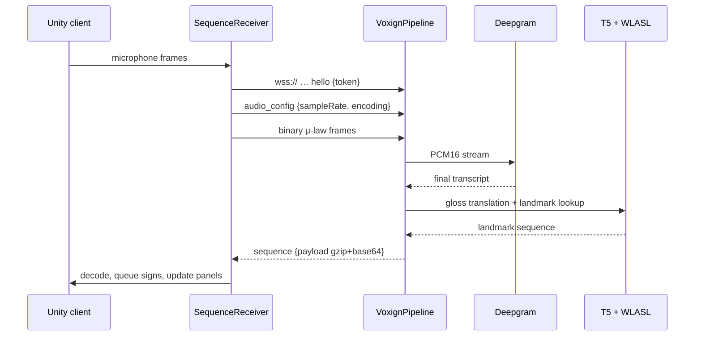

# Scripts and Architecture

This document describes every backend and Unity script, the WebSocket protocol, and how the pieces fit together. Setup instructions are in the [README](../README.md).

## End-to-end flow

- **Client streaming mode** (`VOXIGN_DEV_MODE=0`): Unity captures the microphone and streams it.
- **Backend microphone mode** (`VOXIGN_DEV_MODE=1`, default): the backend records locally; Unity still connects to receive sequences.

## Backend (`Backend/`)

### `VoxignPipeline.py` — entry point and WebSocket bridge

Starts the `websockets` server on `VOXIGN_HOST:VOXIGN_PORT` (default `0.0.0.0:8765`) and owns the whole pipeline.

- **`UnityBridge`**
  - Accepts connections and keeps a set of clients for broadcast.
  - Validates the `hello` message: when `VOXIGN_AUTH_TOKEN` is set, the client token must match (constant-time comparison). Invalid tokens are closed with status **1008**.
  - Routes binary frames to a per-client `ClientAudioSession`; forwards text control messages (`audio_config`, `audio_end`).
  - Broadcasts the completed sequence to every connected client.
- **`ClientAudioSession`** (one per connection)
  - Holds an `asyncio.Queue` (max 64 chunks; oldest is dropped under backpressure).
  - Reads `audio_config` for the sample rate and encoding (`pcm16` or `mulaw`).
  - Decodes μ-law to PCM16 before forwarding to Deepgram.
  - Lazily starts a Deepgram task on the first audio chunk; `audio_end` flushes and closes the Deepgram stream.
  - Cancels/cleans up on disconnect.
- **`SpeechToSignPipeline`**
  - Loads the T5 translator and WLASL library once at startup.
  - `process_transcript`: T5 → gloss, gloss → WLASL words, words → landmark sequence, and writes the debug JSON.
  - Runs T5 inference on a single worker thread so utterances stay ordered.
  - `on_transcript`: logs English/gloss/signs and broadcasts a sequence message with the gzipped, base64-encoded payload.
  - `run`: serves the bridge; in DEV_MODE awaits `microphone_stream`, otherwise waits for client audio.
  - `mark_audio` records the arrival of each audio chunk so the latency row can include the ASR wait.
  - `_record_metrics` appends one row per utterance to `Backend/Logs/latency.csv` and the transcript pair to `Backend/Logs/transcripts.jsonl`. Measurement is enabled by default only when `VOXIGN_DEV_MODE` is on.
- **Environment**
  - `VOXIGN_HOST` (default `0.0.0.0`), `VOXIGN_PORT` (8765)
  - `VOXIGN_DEV_MODE` (1 = backend mic, 0 = client audio)
  - `VOXIGN_AUTH_TOKEN` (empty = auth disabled)
  - `VOXIGN_SEQUENCE_PATH` (debug JSON path; container default `/app/test_sequence.json`)
  - `VOXIGN_METRICS` (default: on in DEV_MODE, off otherwise) and `VOXIGN_METRICS_DIR` (default `Backend/Logs`)

### `SpeechToGloss.py` — Deepgram + T5

- **`GlossTranslator`** loads `Models/t5_asl_gloss/` (config, tokenizer, `model.safetensors`) on CPU or CUDA and translates each sentence with beam search (`gloss_config.json`).
- **`stream_to_deepgram(chunks, on_transcript, sample_rate)`** opens the Deepgram streaming WebSocket (Nova-3, `linear16`, `smart_format`) and runs a sender/receiver pair. When the chunk iterator ends, it sends `CloseStream` so Deepgram flushes the final transcript.
- **`microphone_stream(on_transcript, on_audio=None)`** is the development path: opens PyAudio (lazily imported, so containers do not need PortAudio), reads 1024-sample blocks, and forwards them to Deepgram. `on_audio` is called per captured block so the pipeline can timestamp the latency start.
- **`load_translator()`** validates the model directory and raises `FileNotFoundError` if it is missing.
- The model is `google-t5/t5-small` fine-tuned over 29 epochs (242 MB `model.safetensors`); `gloss_config.json` reports BLEU 74.45, chrF 92.1, and exact-match 79.53.
- `python SpeechToGloss.py` runs a standalone transcript → gloss test.

### `LandmarkExtractor.py` — WLASL library

- Paths: `DATA_DIR = Backend/Data` (`WLASL_parsed_data.json`, `landmarks_V3.npz`); `OUTPUT_PATH = VOXIGN_SEQUENCE_PATH` or `Assets/test_sequence.json`.
- **`LandmarkLibrary`**
  - Loads the parsed JSON and opens the NPZ archive lazily (individual sign arrays are read on demand, so the 8.9 GB archive is not loaded into RAM).
  - Indexes entries by gloss and video ID; selects the entry with the most hand-tracked frames when a gloss has several candidates.
  - `resolve_gloss` prefers multi-word phrases, converts digits to number words, and falls back to fingerspelling (skipping letters with no sign).
  - `build_series` trims idle frames, maps landmarks to points, and attaches gloss/frame metadata.
  - `build_sequence` assembles the final JSON structure.
- `export_sequence` writes via a temporary file and atomic rename.
- Standalone options at the top (`target_sequence`, `target_video_id`, `target_gloss`) allow `python LandmarkExtractor.py` for offline tests.

### `SpeechRecognizer.py`

A small standalone script that streams the microphone to Deepgram and prints raw transcripts. Useful for verifying the key, network, and microphone without loading T5/WLASL.

### `MediapipeTester.py`

Reads `Assets/test_sequence.json` and renders the landmark frames in [Rerun](https://rerun.io) for offline inspection. The `rerun-sdk` package includes the SDK but not the viewer GUI; place a matching viewer binary at `.venv/Scripts/rerun.exe` (Windows) or `.venv/bin/rerun` (Linux), or install it separately.

### `evaluate_wer.py` — word-error evaluation

Computes the word error rate of the recorded Deepgram transcripts against a reference phrase list, for functional requirement FR-02.

- `python Backend/evaluate_wer.py --references phrases.txt` reads `Backend/Logs/transcripts.jsonl` (produced by a DEV_MODE run) and compares the transcripts with the phrases in spoken order.
- Prints per-utterance substitutions, deletions, insertions and WER, the corpus WER, and a pass/fail against the 10 per cent target; `--json results.json` writes a machine-readable summary.
- The reference file has one phrase per line; blank lines and `#` comments are ignored.

### Dependencies and image

- `requirements.txt` — local development: numpy, rerun-sdk, websockets, pyaudio, python-dotenv, torch, transformers, sentencepiece.
- `requirements-prod.txt` — container: numpy, websockets, python-dotenv, transformers, sentencepiece. **PyTorch is installed separately** in the Dockerfile from the CPU index so the correct CPU/ARM wheel is selected. `pyaudio` is absent because production audio comes from Unity.
- `Dockerfile` — Python 3.12-slim, `libgomp1` for torch, CPU torch, production requirements, app code. Models and data are mounted at runtime.
- `.dockerignore` — excludes `.env`, `Data/`, `Models/`, caches.

## Unity scripts (`Assets/Scripts/`)

### Networking and audio

- **`SequenceReceiver`** (on `Louise`, requires `SignPlayer`)
  - Chooses the endpoint: **Server Url** in the editor; **Production Server Url** on device when **Use Production Url On Device** is enabled.
  - Opens `ClientWebSocket` on a background task, sends `hello` with the auth token, and sets a 25 s keepalive.
  - Reconnects with exponential backoff (2 s → 30 s, jittered).
  - A single send pump serializes control messages and binary audio; `SendAudio`/`SendControl` return false while disconnected.
  - Receives fragmented messages, decompresses gzip+base64 sequences, falls back to the exported JSON file for development, and enqueues playback data on the main thread.
  - Raises `onTranscription(string)` and exposes `IsConnected`.
- **`VoiceAudioStreamer`** (on `Louise`, requires `SequenceReceiver`)
  - Requests Android `RECORD_AUDIO` permission when needed.
  - Captures the default microphone at the requested rate, reads 100 ms chunks with wrap handling, and converts to PCM16 or G.711 μ-law.
  - Sends `audio_config` (rate, channels, encoding) and streams frames while connected; sends `audio_end` on stop.
  - `devMode` disables streaming when the backend records its own microphone; it is forced off on mobile.
  - `onStreamingChanged` lets the toggle reflect the real state; permission/device failures invoke it with `false`.
- **`VoiceToggleScript`** (on `VoiceToggle`, requires `Button`)
  - Toggle visuals (knob/colours) with a tween; a Button click flips the state.
  - Finds the `VoiceAudioStreamer` (retries for up to 30 s so it works when `Main` loads additively) and starts/stops capture.
  - Synchronizes the switch if streaming fails or stops externally; exposes `SetValue`, `SetValueWithoutNotify`, `IsOn`.
- **`MainSceneBootstrap`** (on `AppBootstrap` in `VoxignMobileUI`)
  - After one frame, loads `Main` additively if it is not already loaded. The delay lets the editor finish registering its open scenes, preventing duplicate `Main` instances and audio listeners.

### Playback and rig

- **`SignPlayer`** (requires `LandmarkMapper`, `IKSolver`, `AnimationController`)
  - Queues `LandmarkSeries`; plays them in order with a 0.25 s blend between signs.
  - Builds an opening pose, releases unused hands, applies frames at the source frame rate, and raises `SignStarted(string)` at the start of each sign (used by the current-sign UI).
- **`LandmarkMapper`**
  - Converts MediaPipe coordinates (x left, y down, z away) to Unity space, including the source aspect ratio.
  - Maps shoulders/elbows/wrists to upper-arm and forearm directions; maps wrist, hand roll, thumb, and four fingers to bone targets.
- **`IKSolver`**
  - Applies hierarchical bend limits (forearm ≤150°, finger/thumb limits) so poses stay anatomically plausible.
- **`AnimationController`**
  - Caches the arm/hand bone map and rest pose, then each `LateUpdate` resets to rest and aims bones at the current targets.
  - Provides smoothing, transition blending, and hand release; the rig is applied on top of Unity's animation updates.
- **`LandmarkDataTypes`**
  - `LandmarkFrame`, `LandmarkSeries`, `LandmarkSequence`, `BoneTarget`, `BoneRotationSet`.
  - `LandmarkSequence.FromJson` supports both multi-sign and older single-sign exports.
- **`PipelineTester`** (development)
  - Optional component that loads a `TextAsset` (or pasted JSON) and queues its signs on `SignPlayer` at startup, without the backend.

### Measurement (development only)

- **`DevMetrics`** (auto-added to the avatar in the editor and in development builds)
  - Measures **last audio chunk → sequence received** (`speech_to_payload_ms`), **sequence received → first sign rendered** (`payload_to_render_ms`), the average and lowest frame rate during playback, and the outage length on each automatic reconnect.
  - Appends rows to `dev_metrics.csv` in `Application.persistentDataPath` and logs a per-run summary; nothing is attached or compiled into a release build.
  - The audio-to-payload figure is only produced when Unity streams audio (`VoiceAudioStreamer.devMode` off and `VOXIGN_DEV_MODE=0`); the render and frame-rate figures are produced in either mode.

### UI and presentation

- **`TranscriptionUI`** (on `UIRoot`)
  - Binds to `SequenceReceiver.onTranscription` and `SignPlayer.SignStarted` at runtime (retries while `Main` loads).
  - Writes the English transcript to the top panel and the current sign (uppercase) to the chip below it.
  - Hides the chip when playback stops.
- **`CameraOrbit`** (on `Main Camera`)
  - Orbits `mixamorig8:Spine1` with a configurable offset, so the Mixamo feet→hips root shift does not move the framing.
  - Desktop: left-drag to orbit, wheel to zoom. Android: one-finger drag, two-finger pinch.
  - Clamps pitch and distance. Mouse drags that start over UI do not rotate the camera; touch drags orbit from anywhere.

### Editor-only

- **`AndroidManifestPermissions`**
  - `IPostGenerateGradleAndroidProject` hook that adds `INTERNET` and `RECORD_AUDIO`.
  - Adds `usesCleartextTraffic` only for **Development** builds; release builds require `wss://`.
- **`PipelineTester`** is runtime but intended for offline data tests (see above).

## Deploy files (`Deploy/`)

- **`docker-compose.yml`** — production: `backend` (models/data mounted, `DEV_MODE=0`, auth token required) and `caddy` (ports 80/443, automatic TLS, `VOXIGN_DOMAIN`).
- **`docker-compose.local.yml`** — local production-like: backend only, published on 8765, fixed `local-test-token`, no Caddy.
- **`Caddyfile`** — `{$VOXIGN_DOMAIN} { reverse_proxy backend:8765 }`; handles the WebSocket upgrade and certificates.
- **`.env.example`** — template for `Deploy/.env` (`VOXIGN_DOMAIN`, `VOXIGN_AUTH_TOKEN`).
- **`load_test.py`** — opens N authenticated WebSocket clients and holds them open; `--audio` sends μ-law silence and opens Deepgram sessions. Use it to verify auth and concurrency; it does not evaluate recognition accuracy.

## WebSocket protocol

All control messages are UTF-8 JSON text frames; audio is binary.

| Direction | Message | Notes |
|---|---|---|
| Client → server | `{"type":"hello","client":"unity","token":"…"}` | Must be first when auth is enabled; invalid token → close 1008 |
| Client → server | `{"type":"audio_config","sampleRate":16000,"channels":1,"encoding":"mulaw"}` | `mulaw` or `pcm16` |
| Client → server | binary | μ-law bytes (1 byte/sample) or little-endian PCM16 |
| Client → server | `{"type":"audio_end"}` | Flush the current utterance and close the Deepgram stream |
| Server → client | `{"type":"sequence","english":"…","gloss":"…","glossSequence":[...],"payload":"<base64 gzip>","payloadEncoding":"gzip+base64"}` | Full landmark data inline; also written to the debug JSON |
| Server → client | close `1008` | Authentication failure |

The client reconnects automatically. The server broadcasts each sequence to **all** connected clients, so multiple Unity instances (or a test client) receive the same result.

## Configuration reference

### Backend environment

| Variable | Default | Purpose |
|---|---|---|
| `VOXIGN_HOST` | `0.0.0.0` | Bind address |
| `VOXIGN_PORT` | `8765` | Listen port |
| `VOXIGN_DEV_MODE` | `1` | `1` = backend microphone; `0` = Unity streams audio |
| `VOXIGN_AUTH_TOKEN` | empty | Shared secret; empty disables auth |
| `VOXIGN_SEQUENCE_PATH` | `Assets/test_sequence.json` | Debug JSON output; container sets `/app/test_sequence.json` |
| `VOXIGN_METRICS` | on when `VOXIGN_DEV_MODE=1` | Writes the latency CSV and transcript log |
| `VOXIGN_METRICS_DIR` | `Backend/Logs` | Output directory for measurement files |
| `DEEPGRAM_API_KEY` | — | Required; loaded from `Backend/.env` |

### Unity endpoint selection

- Editor: **Server Url** (default `ws://127.0.0.1:8765`).
- Device: **Production Server Url** when **Use Production Url On Device** is on.
- **Auth Token** is sent for both; it must match the backend when auth is enabled.
- `VoiceAudioStreamer.devMode` must be `false` when the backend is in client-streaming mode and `true` when the backend uses its own microphone.

## Measurement runs (development only)

All measurements are off unless the backend runs with `VOXIGN_DEV_MODE=1` (the default) and the client is the editor or a development build.

- **Latency (NFR-01, DR-06).** Start the backend, keep Unity streaming (`VOXIGN_DEV_MODE=0`, `VoiceAudioStreamer.devMode` off), speak one utterance per pause, and stop. `Backend/Logs/latency.csv` holds the stage breakdown (`audio_to_transcript_ms`, `translate_ms`, `lookup_ms`, `encode_ms`, `broadcast_ms`, `pipeline_ms`, `total_ms`) and Unity's `dev_metrics.csv` holds the render half. In backend-microphone mode the CSV still records the stages after the final transcript, but the audio-to-transcript stage is not available.
- **Frame rate (NFR-02).** Any playback run writes the average and lowest frame rate for each utterance to `dev_metrics.csv`. On device the file is in the app's persistent data directory (`/storage/emulated/0/Android/data/<package>/files`).
- **Reconnect (NFR-03).** Interrupt the network or stop the backend during a session; each restored connection writes the outage length as a `reconnect` row and a `[DevMetrics]` log line.
- **Word error rate (FR-02).** Speak the reference phrases in order with the backend in DEV_MODE, then run `python Backend/evaluate_wer.py --references <file>`.

## Lifecycle summary

1. `VoxignMobileUI` starts; `AppBootstrap` loads `Main` additively (skipped if already present in the editor).
2. `Main` starts `SequenceReceiver` (connects, sends `hello`) and `VoiceAudioStreamer` (waits for the toggle or `devMode` setting).
3. `TranscriptionUI` finds the receiver/player and subscribes; `CameraOrbit` frames the avatar.
4. The toggle starts capture; the streamer sends `audio_config` and μ-law frames.
5. The backend decodes audio → Deepgram → T5 → WLASL → gzip sequence broadcast.
6. `SequenceReceiver` decodes, queues signs, updates the transcript; `SignPlayer` raises per-sign events; the chip updates; playback ends and the chip hides.
