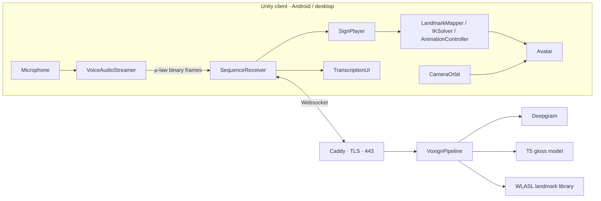

# Voxign

Voxign is an end-to-end, real-time English → American Sign Language translator. Speech is captured on the Unity client (Android or desktop), streamed to a Python backend, transcribed with Deepgram, translated to ASL gloss by a fine-tuned T5-small model, resolved into WLASL landmark sequences, and streamed back to Unity — where the landmarks are converted to bone rotations and played on a rigged avatar.

The project has two runtime modes:

- **Client streaming (production)** — the Unity client captures audio; the backend processes it (`VOXIGN_DEV_MODE=0`).
- **Backend microphone (development)** — the backend records from the machine it runs on (`VOXIGN_DEV_MODE=1`, the default). Used when developing both halves on one PC.

## At a glance

| Capability | Implementation |
|---|---|
| Client audio capture | `VoiceAudioStreamer` — 16 kHz, 100 ms chunks, G.711 μ-law (2× less bandwidth) |
| Transport | WebSocket; `ws://` locally, `wss://` in production, optional shared-secret auth |
| Speech-to-text | Deepgram Nova-3 streaming |
| Gloss translation | T5-small fine-tuned on English → ASL gloss |
| Landmark source | WLASL parsed data + landmark NPZ archive |
| Playback | `SignPlayer` → `LandmarkMapper` → `IKSolver` → `AnimationController` |
| UI | Voice toggle, live transcript, current-sign chip, orbit/zoom camera |
| Deployment | Docker + Caddy TLS on Oracle Cloud Always Free (or any Docker host) |

## Architecture



1. The client opens a WebSocket and sends a handshake message `hello` (with an optional auth token), then `audio_config`, then binary audio frames.
2. The backend decodes μ-law (compressed) audio frames, forwards PCM16 to Deepgram, and receives final transcripts.
3. Transcripts are translated to gloss, resolved against WLASL, and built into a landmark sequence.
4. The sequence JSON is gzipped, base64-encoded, and broadcast to all connected clients (yet to implement proper automated session token handling).
5. Unity decodes the payload, queues each sign, and plays it on the avatar. The transcript panel and the current-sign chip update in sync.

Detailed protocol messages, script responsibilities, and configuration references are explained in **[Scripts.md](Docs/Scripts.md)**.

## Repository layout

```
Assets/                    Unity project (scripts, scenes, avatar, UI sprites)
Backend/                   Python pipeline
  VoxignPipeline.py        WebSocket server + pipeline entry point
  SpeechToGloss.py         Deepgram streaming + T5 gloss translator
  LandmarkExtractor.py     WLASL library + sequence builder
  SpeechRecognizer.py      Standalone Deepgram transcript test
  MediapipeTester.py       Offline Rerun visualization
  Data/                    WLASL data (not committed, ~8.9 GB)
  Models/t5_asl_gloss/     T5 model (Git LFS)
  requirements.txt         Local development dependencies
  requirements-prod.txt    Container dependencies
  Dockerfile
  .dockerignore
Deploy/
  docker-compose.yml       Production: backend + Caddy TLS
  docker-compose.local.yml Local production version: backend only
  Caddyfile
  .env.example             Example production env
  load_test.py             Multi-client load test
Packages/  ProjectSettings/  Unity project configuration
Docs/Scripts.md            Script and protocol reference
```

## Prerequisites

- **Python 3.12 or 3.13** for local development. The production container uses 3.12. PyAudio must have a wheel for whichever local version you use (3.13 is verified) because backend-microphone mode needs it.
- **Unity 6000.4.9f1** (or the exact version in `ProjectSettings/ProjectVersion.txt`) with **Android Build Support** (SDK, NDK, OpenJDK) for phone builds. The project uses URP and the new Input System.
- **Deepgram API key** — create one at [deepgram.com](https://deepgram.com) and store it in `Backend/.env`:
  ```
  DEEPGRAM_API_KEY=your_key_here
  ```
- **WLASL landmark data** — download from [Kaggle: "Mutemotion: WLASL Mediapipe Encoded"](https://www.kaggle.com/datasets/abd0kamel/mutemotion-output):
  - `landmarks_V3.npz` → `Backend/Data/`
  - `WLASL_parsed_data.json` → `Backend/Data/`
- **T5 model** — The model parameters folder `Backend/Models/t5_asl_gloss/` is tracked via **Git LFS**. Run `git lfs install` and `git lfs pull` after cloning. The avatar (FBX) and image assets use the same LFS rules in `.gitattributes`.
- **Docker Desktop** (local production-like testing) or **Docker Engine + Compose** (server).
- **A public host and domain** for production. Oracle Cloud Always Free is the documented target; any Docker host with ports 80/443 works.

## Quick start — local development

#### NB: Unity parameters are not to be set within the code itself. Open the project in the Unity Editor and set the values in the Scene inspector. Expand the `Main` scene and click `Louise` to open the inspector panel (or right click to open the Properties window). Scroll down to find `Sequence Receiver` and `Voice Audio Streamer` 

### Option A: Backend-microphone mode (original workflow)

Use this when testing/developing both halves of the system on one machine. 

Instead of deferring audio recording to the client (Unity/mobile device), this setup allows you to bypass the client entirely as an audio source. `VoxignPipeline` includes its own voice capture module via PyAudio, allowing the backend to handle capture, transcription and translation at once, leaving Unity to only handle the animation side of things. This also allows for more precise start/stop control of the backend compared to the production setups. 


1. **Create a Python environment and install dependencies** (from the repo root):
   ```powershell
   python -m venv .venv
   .venv\Scripts\activate
   pip install -r Backend/requirements.txt
   ```
   On macOS/Linux use `source .venv/bin/activate`.

2. **Add the data, model, and Deepgram key** as described in Prerequisites.

3. **Run the backend**:
   ```powershell
   cd Backend
   python VoxignPipeline.py
   ```
   Defaults: `VOXIGN_DEV_MODE=1`, `VOXIGN_HOST=0.0.0.0`, `VOXIGN_PORT=8765`. Authentication is disabled unless `VOXIGN_AUTH_TOKEN` is set.

4. **Open Unity** at the repository root. Open `Assets/Scenes/VoxignMobileUI.unity` (you may keep `Main.unity` open too — `AppBootstrap` skips loading it if it is already present). In `Main` → `Louise`:
   - `Sequence Receiver` → **Server Url**: `ws://127.0.0.1:8765` (localhost port 8765)
   - **Auth Token**: empty, or the token if you set `VOXIGN_AUTH_TOKEN`
   - `Voice Audio Streamer` → **Dev Mode**: `true` (Unity must not stream while the backend uses its own microphone)

   Press Play. The UI connects to the backend; speak into the PC microphone. The transcript and sign panels update as the avatar signs.

### Option B: Production-like local mode (client streams audio)

Use this to exercise the same path as the deployed server, including auth, μ-law audio, and gzip payloads.

Allows you to use the built application on your actual mobile device, while a docker container on your PC serves as the backend. (Both devices must be connected to the same network)

1. **Docker Desktop** running with **Linux containers**, `Backend/.env` populated.
2. **Start the local stack** (from the repo root):
   ```powershell
   docker compose -p voxign-local -f Deploy/docker-compose.local.yml up -d --build
   ```
   This publishes `8765`, sets `VOXIGN_DEV_MODE=0`, and uses the fixed test token `local-test-token`. It does not touch other containers.
3. **Unity** (`Main` → `Louise`):
   - `Sequence Receiver` → **Server Url**: `ws://127.0.0.1:8765`
   - **Auth Token**: `local-test-token`
   - `Voice Audio Streamer` → **Dev Mode**: `false`
4. Press Play and speak. The client microphone streams to the backend.
5. **Logs / lifecycle**:
   ```powershell
   docker logs -f voxign-local-backend-1
   docker compose -p voxign-local -f Deploy/docker-compose.local.yml down
   ```
6. **Concurrent-client test**:
   ```powershell
   python Deploy/load_test.py --clients 3 --seconds 10
   python Deploy/load_test.py --clients 1 --seconds 5 --audio
   ```
   Without `--audio`, this only exercises connections and auth (no Deepgram cost). `--audio` sends 1 s of μ-law silence and opens a real Deepgram session.

### Testing from a phone on the LAN

1. Set `Sequence Receiver` → **Production Server Url** to `ws://<PC-LAN-IP>:8765` (**LAN** IP, not your ISP one) and **Auth Token** to `local-test-token`. 
   (Run `VoxignPipeline.py` once to print you a list of your current LAN addresses)
2. Build a **Development** APK (cleartext/unencrypted `ws://` is only enabled for development builds).
3. Allow inbound TCP 8765 on Windows Firewall (elevated PowerShell):
   ```powershell
   New-NetFirewallRule -DisplayName "Voxign Backend (TCP 8765)" -Direction Inbound -Protocol TCP -LocalPort 8765 -Action Allow -Profile Private
   ```
4. Again, both devices must be on the same network. If the PC's IP changes (happens occasionally due to ISP behaviour), update the URL in `Sequence Receiver`.

## Unity project setup

### Scenes

- Primary scenes:
  1. `Assets/Scenes/VoxignMobileUI.unity` (first/startup)
  2. `Assets/Scenes/Main.unity`
- `VoxignMobileUI` contains the UI canvas, `EventSystem`, and `AppBootstrap`.
- `AppBootstrap` (`MainSceneBootstrap`) loads `Main` additively after one frame if it is not already loaded, so the player can keep both scenes open without duplicates.
- `Main` contains `Louise` (Animator, `LandmarkMapper`, `RigBuilder`, `AnimationController`, `IKSolver`, `PipelineTester`, `SignPlayer`, `SequenceReceiver`, `VoiceAudioStreamer`), the `Main Camera` with `CameraOrbit`, the directional light, and the global volume.

### Network and audio configuration

| Component | Field | Purpose |
|---|---|---|
| `SequenceReceiver` | **1. Server Url** | Endpoint used in the editor (`ws://127.0.0.1:8765` by default) |
| | **2. Production Server Url** | Endpoint used on device (`wss://<domain>/ws` in production) |
| | **3. Use Production Url On Device** | Enables the production URL on mobile |
| | **4. Auth Token** | Must match `VOXIGN_AUTH_TOKEN` on the backend (empty when auth is disabled) |
| | **5. Reconnect Delay / Max Reconnect Delay / Keep Alive Seconds** | Reconnection backoff (2 s → 30 s, jittered) and WebSocket keepalive |
| `VoiceAudioStreamer` | **1. Sample Rate / Chunk Milliseconds** | Defaults 16000 Hz / 100 ms |
| | **2. Dev Mode** | `true` when the backend records its own microphone; `false` when the client streams |
| | **3. Compress Audio** | G.711 μ-law encoding (halves audio bandwidth) |
| `VoiceToggleScript` | **1. Control Streaming** | Binds the toggle to the streamer |
| | **2. Is On** | Initial switch state; `true` starts the microphone on mobile at launch |

The toggle binds to the streamer at runtime (across additive scenes), starts/stops capture, and reverts to OFF if the microphone permission or device fails. The camera orbits `mixamorig8:Spine1` (immune to the Mixamo root shift): rotate/zoom with LMB-drag/scroll on desktop, one-finger drag/pinch on Android.

The scene's switch is **ON** by default. On mobile that starts capture at launch (and triggers the microphone prompt). Set **Is On** off in the scene if you want the app to start silent.

The scene currently holds the local production-test values (`ws://<my ip address ;)>:8765`, `local-test-token`, `devMode=false`). Replace them with your own environment's values before building; see the local and deployment sections.

### Android build

1. Switch the build target to **Android** (`File → Build Profiles → Android`) and select the Android Build Support modules.
2. Player Settings (at the top of the window):
   - **Minimum API level**: 25 (set in the project)
   - **Scripting Backend**: IL2CPP
   - **Target Architectures**: ARM64
   - **Package name**: Template default (`com.UnityTechnologies.com.unity.template.urpblank`), will be changed before Google Play Store deployment
3. The editor script `AndroidManifestPermissions` adds `INTERNET` and `RECORD_AUDIO` to the generated manifest. It adds `usesCleartextTraffic` **only for Development builds**; release builds require `wss://` (encrypted).
4. **Development build** → use `ws://` for LAN testing.
5. **Release build** → use `wss://` with the deployed backend. The first launch prompts for microphone permission.

## Deployment — Oracle Cloud Always Free

### 1. Instance

| Setting | Value |
|---|---|
| Shape | `VM.Standard.A1.Flex` (Ampere ARM) |
| OCPUs / RAM | **2 OCPU / 12 GB** is ample; **4 / 24** is the full Always Free A1 allowance |
| Image | Canonical **Ubuntu 24.04** (aarch64) |
| Boot volume | **100 GB** balanced (within the 200 GB Always Free block storage) |
| Networking | Public subnet + public IPv4, then **reserve** the IP |
| SSH | Add your public key (no password login) |
| Region | Your tenancy's home region (Always Free A1 is home-region only) |

If you get “Out of host capacity”, try another zone, retry later or upgrade the account to Pay As You Go (Always Free resources stay free; set a budget alert and create only the free resources).

### 2. Network and firewall

- **VCN security list / NSG ingress**:
  - TCP 22 from your IP (or `0.0.0.0/0` temporarily), this is your SSH access
  - TCP 80 from `0.0.0.0/0` (Caddy HTTP challenge)
  - TCP 443 from `0.0.0.0/0`
  - Do **not** expose 8765 publicly.
- Oracle's Ubuntu images also block ports in the host firewall. Open them:
  ```bash
  sudo iptables -I INPUT 6 -m state --state NEW -p tcp --dport 80 -j ACCEPT
  sudo iptables -I INPUT 6 -m state --state NEW -p tcp --dport 443 -j ACCEPT
  sudo apt install -y iptables-persistent
  sudo netfilter-persistent save
  ```

### 3. Server installation

```bash
sudo apt update
sudo apt install -y git git-lfs docker.io docker-compose-v2 rsync
sudo usermod -aG docker $USER
newgrp docker

git clone <your-repo-url> ~/Voxign
cd ~/Voxign
git lfs install
git lfs pull
```

Make sure the `Deploy/` and `Backend/` files you are deploying (including `Backend/Dockerfile`, `Backend/requirements-prod.txt`, and `Deploy/.env.example`) are committed and pushed to the remote you clone from.

`Backend/Data` is not in the repository. Copy it from your PC (8.31 GB):
```bash
# on the server
mkdir -p ~/Voxign/Backend/Data

# on the PC, from the repo root (scp is built into Windows OpenSSH;
# use rsync -av --progress instead if you have it, for resumability)
scp Backend/Data/landmarks_V3.npz Backend/Data/WLASL_parsed_data.json ubuntu@<server-ip>:~/Voxign/Backend/Data/
```
Or download the files directly to the server from Kaggle if you have Kaggle credentials.

Create the environment files:
```bash
nano Backend/.env
# DEEPGRAM_API_KEY=...

cp Deploy/.env.example Deploy/.env
nano Deploy/.env
# VOXIGN_DOMAIN=api.yourdomain.com
# VOXIGN_AUTH_TOKEN=<openssl rand -hex 32>
```
Use the same token in Unity (`SequenceReceiver` → **Auth Token**) and keep it out of source control. Restrict the files:
```bash
chmod 600 Backend/.env Deploy/.env
```

### 4. Start the production stack

```bash
cd ~/Voxign
docker compose -f Deploy/docker-compose.yml up -d --build
docker compose -f Deploy/docker-compose.yml logs -f backend
```

The backend image installs CPU-only PyTorch (works on x86-64 and aarch64), uses `Backend/requirements-prod.txt`, and mounts `Backend/Data` and `Backend/Models` read-only. Caddy terminates TLS and proxies to the backend on the internal network.

### 5. DNS and TLS

- Create an **A record**: `api.yourdomain.com` → reserved public IPv4.
- If you use Cloudflare DNS, set the record to **DNS only (grey cloud)** so Caddy's HTTP-01 challenge can succeed. A Cloudflare Tunnel is an alternative to Caddy if you do not want to expose ports.
- Caddy obtains and renews the certificate automatically. Check:
  ```bash
  curl -I https://api.yourdomain.com/
  ```
  A plain HTTP request to the WebSocket endpoint may return 400/426; that is expected.

### 6. Point the app at the deployment

In `Main` → `Louise` → `Sequence Receiver`:
- **Production Server Url**: `wss://api.yourdomain.com/ws`
- **Auth Token**: the value from `Deploy/.env`
- **Use Production Url On Device**: `true`

Build a **release** APK (Development Build off) so the manifest enforces TLS. The client connects from any network — only outbound 443 is required.

### 7. Verify

```bash
docker compose -f Deploy/docker-compose.yml ps
docker compose -f Deploy/docker-compose.yml logs -f backend
# from your PC
python Deploy/load_test.py --url wss://api.yourdomain.com/ws --token <token> --clients 2 --seconds 5
```
Expect the backend to log the model/library loading, `Unity bridge listening`, `Authentication: required`, then client connections and audio.

### 8. Updating and operations

```bash
git pull
git lfs pull
docker compose -f Deploy/docker-compose.yml up -d --build
docker compose -f Deploy/docker-compose.yml logs -f backend
docker compose -f Deploy/docker-compose.yml restart backend
docker compose -f Deploy/docker-compose.yml down
```

Model or data updates are picked up after replacing the files and restarting the stack (the mounts are read-only).

## Operations and troubleshooting

| Symptom | Likely cause / fix |
|---|---|
| Backend exits at startup | Missing `Backend/Data` files, model directory, or `DEEPGRAM_API_KEY` |
| Model directory is empty after cloning | Run `git lfs pull`; if the objects were never pushed, run `git lfs push --all origin` from your PC first |
| Client closes with `1008` / “unauthorized” | `Auth Token` in Unity does not match `VOXIGN_AUTH_TOKEN` |
| TLS certificate fails | DNS not pointing at the server, ports 80/443 closed, or Cloudflare proxying during HTTP-01 |
| Phone cannot connect on LAN | Wrong PC IP, Windows Firewall, or the phone is on a different network |
| Phone connects but no audio | Release build using `ws://` (cleartext disabled) — use a Development build or `wss://` |
| No transcripts | Microphone permission denied, wrong default device, Deepgram key/network, or `VOXIGN_DEV_MODE` mismatch |
| Avatar not visible | `Main` not in Build Settings, scene order wrong, or `AppBootstrap` missing |
| Two audio listeners | Fixed in the current code; the editor may keep both scenes open safely |
| Slow first start | Model/library loading; keep the container warm and always-on |
| Docker build cannot resolve torch on ARM | Pin a torch version that publishes aarch64 CPU wheels in `Backend/Dockerfile` (the official CPU index is used) |

### Security notes

- Keep `DEEPGRAM_API_KEY` on the server (in `Backend/.env`); never ship it in the APK.
- The shared `VOXIGN_AUTH_TOKEN` is compiled into the app; use long random values and rotate it for releases. Per-user tokens are a future improvement.
- Only 22/80/443 are public; 8765 stays on the Docker network.
- Use SSH keys, TLS, and a firewall; do not run the backend with `VOXIGN_HOST=0.0.0.0` on an untrusted network without auth.

### Design notes and limits

- Audio uses **G.711 μ-law** (2× less bandwidth, lossless enough for STT). The landmark payload is **gzip + base64** (~2.4× smaller for a typical sequence). Opus remains a future upgrade if more audio compression is needed.
- The backend runs a **single T5 worker** to keep utterances ordered; concurrent clients share it. Deepgram sessions are per client.
- A **single long-lived process** is required (WebSocket + loaded models). Serverless/Lambda is not a good fit.
- Oracle Always Free includes 4 OCPU / 24 GB A1, 200 GB block storage, and 10 TB egress per month; keep the voice switch off when idle to avoid unnecessary Deepgram usage.
- The WLASL dataset is ~8.3 GB and must be on the host; it is not baked into the image.

## Script reference

See **[Docs/Scripts.md](Docs/Scripts.md)** for every backend and Unity script, the WebSocket protocol, configuration fields, and how the pieces fit together.

---

Voxign's current production stage is single-client deployment. Per-user authentication and additional hardening are the next planned improvements. For enquiries: [nj.muranga@gmail.com](mailto:nj.muranga@gmail.com).
